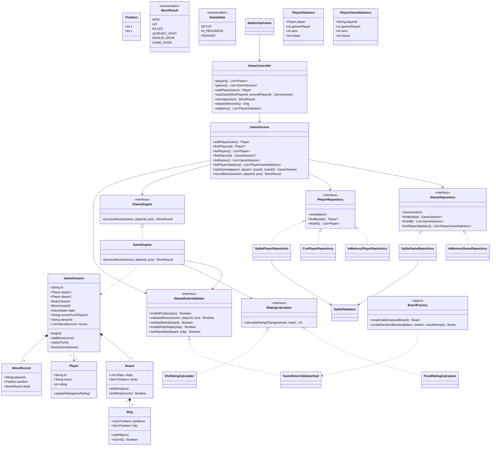

# Архитектура Battleship

## Модули

- `core` содержит модели партии, правила, игровой сервис и движок, генератор доски, рейтинг и интерфейсы репозиториев. Он не зависит от UI.
- `cli` принимает команды, вызывает API `core` и отображает поля и журнал.
- `gui` содержит Swing-приложение, контроллер, статистику и таблицу истории партий.
- `persistence` реализует интерфейсы репозиториев поверх SQLite и зависит от `core`, но не от UI.

## Модели

- `Position(x, y)` — координаты клетки.
- `Ship(positions)` хранит клетки корабля и попадания; `isSunk()` проверяет, поражены ли все клетки.
- `Board(ships)` содержит корабли и набор выстрелов, сделанных по этой доске. `isAllShipsSunk()` проверяет победу над флотом.
- `Player(id, name, rating)` хранит игрока и его рейтинг.
- `GameSession(id, player1, player2, board1, board2)` хранит две доски, состояние, текущего игрока, победителя и журнал `MoveRecord(playerId, position, result)`.
- `GameState`: `SETUP`, `IN_PROGRESS`, `FINISHED`.
- `MoveResult`: `MISS`, `HIT`, `KILLED`, `ALREADY_SHOT`, `INVALID_MOVE`, `GAME_OVER`.

## Сервисы и интерфейсы core

- `IGameRulesValidator` и `GameRulesValidatorImpl` проверяют координаты и ходы, форму корабля, допустимость его размещения и полную классическую расстановку из десяти кораблей (`1x4`, `2x3`, `3x2`, `4x1`).
- `GameService` реализует сценарии добавления и поиска игроков, создания проверенной партии и записи хода. При старте он проверяет обе доски и переводит сессию из `SETUP` в `IN_PROGRESS`; запись результата в журнал и сохранение партии также выполняются сервисом.
- `GameEngine.processMove(session, playerId, pos)` проверяет выстрел, обновляет попадания, очередь, состояние партии и рейтинг при победе.
- `IRatingCalculator.calculateRatingChange(winner, loser)` предоставляет величину изменения рейтинга. GUI и CLI используют `EloRatingCalculator` с K=32; `FixedRatingCalculator` оставлен как простая фиксированная политика.
- `IPlayerRepository` и `IGameRepository` задают операции `save`, `findById` и `findAll`; `IGameRepository` также предоставляет статистику партий по игроку. `InMemoryPlayerRepository` и `InMemoryGameRepository` остаются адаптерами для тестов.
- `SqliteDatabase`, `SqlitePlayerRepository` и `SqliteGameRepository` находятся в модуле `persistence`. Игроки, партии, доски, корабли, выстрелы, журнал ходов и статистика записываются в таблицы SQLite.
- `BoardFactory.createRandomBoard()` генерирует случайную классическую расстановку.
- `GameController` связывает UI с `GameService`, управляет текущей партией, таймером и локальными статистиками.
- `BattleshipFrame` отрисовывает оба поля, счёт и историю, позволяет добавлять игроков/запускать партию/делать выстрелы и сворачивать таблицу игроков.
- `CsvPlayerRepository` сохранён как адаптер для импорта ранее созданного `~/.sea-battle/players.csv`; GUI переносит отсутствующие в SQLite профили, не перезаписывая уже сохранённые данные.
- Таблица `player_statistics` хранит число начатых партий, побед и поражений. Счётчик игр увеличивается при первой записи партии, а победа/поражение — только при переходе в `FINISHED`; повторное сохранение завершённой партии не дублирует результат.
- CLI и GUI используют общую базу `~/.sea-battle/battleship.db`. Партия восстанавливается из сохранённых досок, попаданий, выстрелов, очереди и журнала ходов.

GUI запускается командой `./gradlew :gui:run`.

## Поток партии

1. CLI или GUI создаёт игроков через `IPlayerRepository`, генерирует обе доски и передаёт их в `GameService.startGame`.
2. `GameService` проверяет обе расстановки через `IGameRulesValidator`; невалидные доски не запускают партию. При успехе сессия переходит из `SETUP` в `IN_PROGRESS` и сохраняется через `IGameRepository`.
3. SQLite-репозиторий транзакционно записывает новую партию, обе доски и увеличивает счётчик игр обоих игроков.
4. UI передаёт выстрел сервису. Сервис вызывает `GameEngine.processMove`, заносит результат (в том числе отклонённую попытку) в `GameSession.moves` и сохраняет сессию.
5. Движок проверяет состояние, очередь и координаты. Повторный выстрел возвращает `ALREADY_SHOT`; попадание оставляет ход текущему игроку, промах передаёт очередь. Потопление последнего корабля завершает партию и обновляет рейтинг.
6. При переходе партии в `FINISHED` репозиторий один раз увеличивает статистику победителя и проигравшего. Состояние игры, рейтинг и статистика хранятся в базе и доступны после перезапуска.
7. GUI отображает поля, счёт попаданий, таймер, журнал ходов, статистику игроков и историю партий. CLI выводит данные из той же базы SQLite.

## Диаграмма

