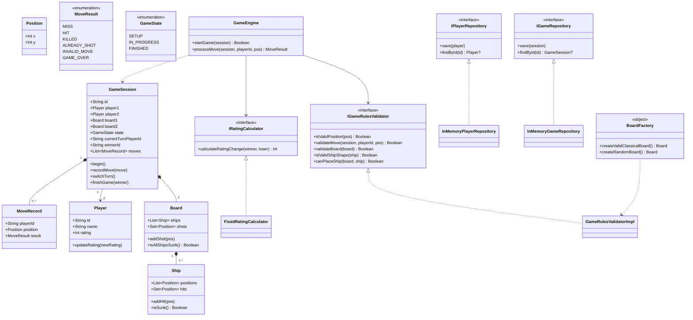

# Архитектура Battleship

## Модули

- `core` содержит модели партии, правила, игровой движок, генератор доски, рейтинг и интерфейсы репозиториев. Он не зависит от CLI.
- `cli` принимает команды, вызывает API `core`, отображает поля и журнал. Единственная реализация репозиториев сейчас хранит данные в `MutableMap`.
- `gui` пока не содержит реализации игрового интерфейса.

## Модели

- `Position(x, y)` — координаты клетки.
- `Ship(positions)` хранит клетки корабля и попадания; `isSunk()` проверяет, поражены ли все клетки.
- `Board(ships)` содержит корабли и набор выстрелов, сделанных по этой доске. `isAllShipsSunk()` проверяет победу над флотом.
- `Player(id, name, rating)` хранит игрока и его рейтинг.
- `GameSession(id, player1, player2, board1, board2)` хранит две доски, состояние, текущего игрока, победителя и журнал `MoveRecord(playerId, position, result)`.
- `GameState`: `SETUP`, `IN_PROGRESS`, `FINISHED`.
- `MoveResult`: `MISS`, `HIT`, `KILLED`, `ALREADY_SHOT`, `INVALID_MOVE`, `GAME_OVER`.

## Сервисы и интерфейсы core

- `IGameRulesValidator` и `GameRulesValidatorImpl` проверяют координаты и ходы, форму корабля, допустимость его размещения и полную классическую расстановку из десяти кораблей (`1x4`, `2x3`, `3x2`, `4x1`).
- `GameEngine` координирует запуск и обработку хода. `startGame(session)` валидирует обе доски и переводит сессию из `SETUP` в `IN_PROGRESS` только при успешной проверке. `processMove(session, playerId, pos)` записывает результат каждой попытки в журнал, обновляет попадания и очередь. При победе завершает сессию и применяет рейтинг.
- `IRatingCalculator.calculateRatingChange(winner, loser)` предоставляет величину изменения рейтинга. `FixedRatingCalculator` возвращает 10; движок добавляет эти очки победителю и вычитает их у проигравшего.
- `IPlayerRepository` и `IGameRepository` задают операции `save` и `findById`. `InMemoryPlayerRepository` и `InMemoryGameRepository` реализуют их на `MutableMap`.
- `BoardFactory.createRandomBoard()` генерирует случайную классическую расстановку.

## Поток партии

1. CLI создаёт игроков через `IPlayerRepository`, генерирует обе доски и собирает `GameSession` в состоянии `SETUP`.
2. CLI вызывает `GameEngine.startGame`. Если `IGameRulesValidator.validateBoard` отклоняет любую доску, партия не сохраняется и не начинается. При успехе сессия становится `IN_PROGRESS`.
3. Команда `move` передаётся в `GameEngine.processMove`. Валидатор проверяет состояние, очередь и координаты. Повторный выстрел возвращает `ALREADY_SHOT`; недопустимая попытка возвращает `INVALID_MOVE`.
4. Для новой допустимой клетки движок записывает выстрел. Попадание оставляет ход текущему игроку, промах передаёт очередь. Потопление последнего корабля переводит партию в `FINISHED`, задаёт победителя и обновляет рейтинг.
5. Результат попытки добавляется в `GameSession.moves`. CLI сохраняет сессию через `IGameRepository` и выводит очередь (либо победителя по завершении), доступное игроку представление досок и журнал.

## Диаграмма

